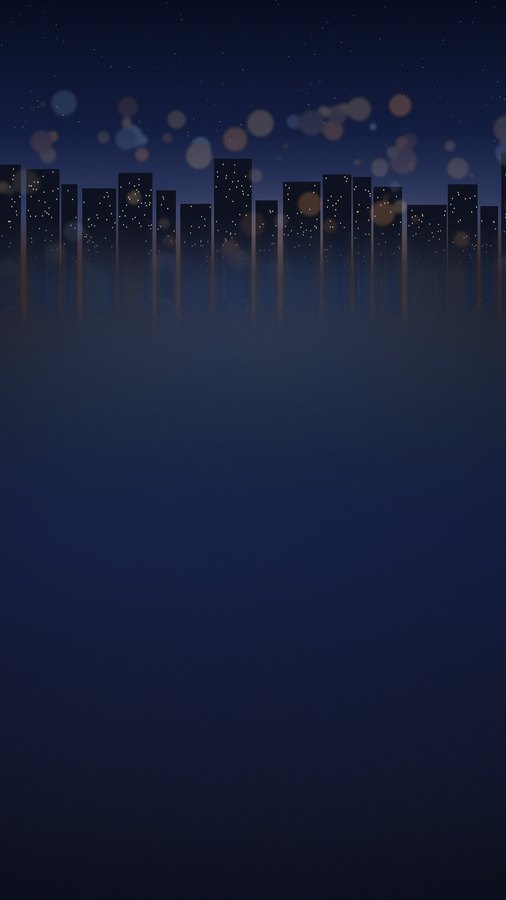
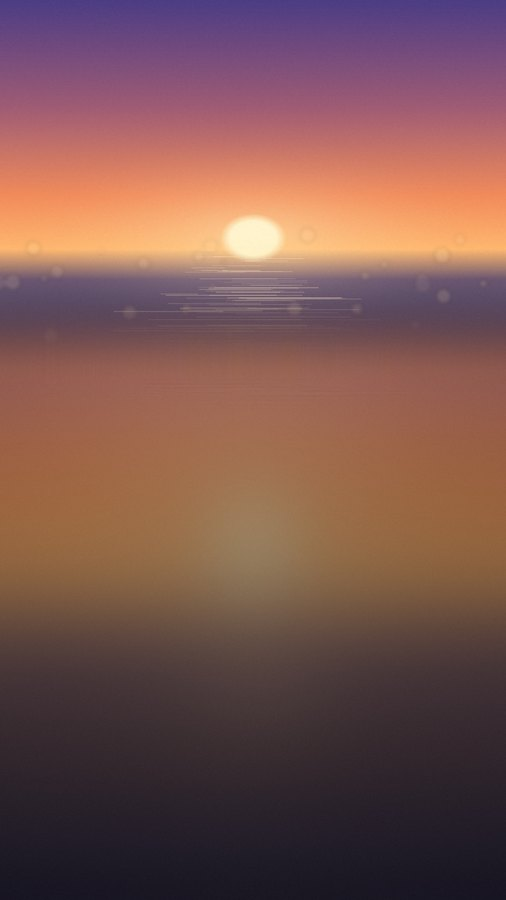
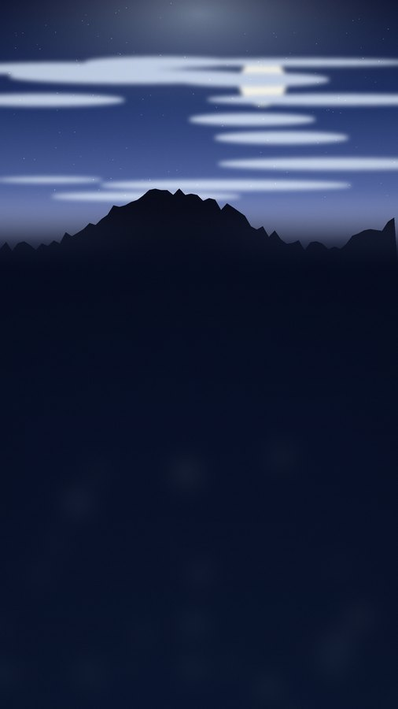

# hydro-wallpaper

把任意一张图做成「氢桌面」风格壁纸：**上面是图，下面是从这张图里"长出来"的颜色。**

对齐一加氢 OS 1.0 氢桌面的「33% 的自由度」——原图只占屏幕上部一块，其余交给延伸背景。
比例、分辨率、延伸方式全部由调用时指定。纯确定性图像处理，不依赖 AI 生成，几秒出图。

<p align="center">
  
  
  
  
</p>

<p align="center">
  <sub>从左到右：extend 取色延展 · blur 模糊填充 · blur-mix 叠化 · splice_blur 双图拼接</sub><br>
  <sub>示例源图由 <code>assets/generate_demo_sources.py</code> 程序化生成，100% 原创，可自行复现</sub>
</p>

---

## 它解决什么问题

手机壁纸是 9:16 甚至更窄，而大多数好图是横的、方的、或者比例不搭。
常见的做法有两种，都有毛病：

- **居中裁切**：把两侧内容裁掉，人物被砍、构图毁掉
- **上下补黑边/纯色**：像贴在黑板上，接缝一条硬线

这个工具做第三件事：**从图的接缝处取色，把图自己的颜色往下延伸**，
让下半屏看起来像是这张图自然"流"下去的。接缝在数值上识别不出
（实测跳变 0.003~0.007，和全图平均行间差同量级）。

## 五种方案

| 方案 | 做法 | 适合 |
| --- | --- | --- |
| **extend** | 按列取接缝颜色向下抹，再收敛到提纯后的代表色渐变 | 完整场景图、背景不抢戏 |
| **subject** | 抠出主体，背景交给渐变，主体按原构图位置叠回，可跨接缝溢出 | 有明确主角、背景杂乱 |
| **crop closeup** | 从原图裁一块（人像+光斑+裙摆）放大铺满图像区 | 主体只占一角，想做特写 |
| **blur** | 把图像放大后强模糊铺满延伸区，保留原图色彩结构 | 想要氛围感、原图色彩丰富 |
| **splice_blur** | 上图入画，**另一张图**高斯模糊铺满延伸区 | 你手上有两张图要拼一起 |

前四种可以组合。`--blur-mix 0.5` 让模糊作为取色渐变上的一层氛围：

```bash
python scripts/hydro_engine.py photo.png -o out.png --anchor 0.42 --blur-mix 0.55
```

`splice_blur` 不能和它们叠——它模糊的是**第二张图**，走独立脚本。

## 安装

只需要 Python 3.9+。本技能是 [Myskill](../) 仓库里的一个子目录：

```bash
# 方式一：clone 整个技能集，用其中一个
git clone https://github.com/shinayaaa/Myskill.git
cd Myskill/hydro-wallpaper

# 方式二：只要这一个（稀疏检出，不下载其他技能）
git clone --depth 1 --filter=blob:none --sparse https://github.com/shinayaaa/Myskill.git
cd Myskill && git sparse-checkout set hydro-wallpaper && cd hydro-wallpaper

# 核心依赖（extend / blur / 裁切特写 / splice_blur 够用）
pip install numpy pillow
```

抠图模式（`--mode subject`）额外需要：

```bash
pip install rembg onnxruntime
```

> `rembg` 首次运行会下载 `u2net` 模型（**176 MB**）。国内网络容易断流，
> 用带断点续传的下载器提前拉好，中断了重跑同一条命令即可接着下：
>
> ```bash
> python scripts/download_u2net.py
> ```

也可以一键建独立虚拟环境（不污染系统 Python）：

```bash
python setup_env.py              # 完整安装
python setup_env.py --core-only  # 只装核心，秒装
```

## 快速开始

```bash
# 方案一 extend：最常用，干净抽象
python scripts/hydro_engine.py photo.png -o out.png --ratio 9:16 --anchor 0.33

# 方案四 blur：保留原图明暗与色彩分布，更有氛围
python scripts/hydro_engine.py photo.png -o out.png \
    --width 1280 --height 2772 --anchor 0.55 --mode blur

# 方案二 subject：抠出主体，背景交给渐变
python scripts/hydro_engine.py photo.png -o out.png \
    --ratio 9:16 --anchor 0.33 --mode subject \
    --subject-overflow 0.16 --subject-model u2net

# 方案五 splice_blur：两张图上下拼接
python scripts/splice_blur.py top.png bottom.png -o out.png \
    --width 1280 --height 2772 --focus-y 0.22

# 指定分辨率（只给一边会按比例推另一边）
python scripts/hydro_engine.py photo.png -o out.png --width 1440        # → 1440x2560
python scripts/hydro_engine.py photo.png -o out.png --width 1080 --height 2400
```

想看清楚引擎到底做了什么，加 `--json`，会输出实际生效的全部参数、取到的代表色、
图像区/延伸区像素高度。

### 方案三：裁切特写要先量边界

跳过测量直接猜参数，必然反复返工。

```bash
python scripts/probe_subject.py photo.png \
    --region 400,300,1450,1900 \
    --glow-box 250,120,900,470 \
    --canvas 1280x2772
```

输出长这样：

```
[光斑] 1386 px  行 352..471  列 308..415  中心 (362, 412)  长宽比 1.11 填充率 0.11
[线稿主体] 230821 px  行 350..1621  列 400..1337
[最宽段/裙摆] 行 1300..1350  列 430..1327  跨度 897 px
[推荐裁切框] 360,270 .. 1377,1721   尺寸 1017x1451  宽高比 0.701
[anchor 换算] 刚好不裁纵向所需的最小 anchor = 0.659
```

**anchor 不是想给多少给多少，它受裁片宽高比硬约束。** 引擎是 `object-fit: cover`：

```
裁片放大到宽度铺满时的实际高度 = 画布宽 ÷ (裁片宽 ÷ 裁片高)
需要的高度（可用空间）        = 画布高 × anchor
```

- 可用空间 ≥ 实际高度 → 纵向不裁任何东西，只裁左右 ✅
- 可用空间 < 实际高度 → **会裁掉上下内容**，裙摆/光斑可能被切 ⚠️

## 参数速查

### 主参数

| 参数 | 默认 | 作用 |
| --- | --- | --- |
| `--ratio` | `9:16` | 宽高比，也可 `3:4` / `16:9` / `21:9` / `1:1` |
| `--width` / `--height` | — | 显式分辨率 |
| `--long-edge` | 1920 | 两者都没给时的长边像素 |
| `--anchor` | **0.33** | 图像区占画布高的比例（"33% 的自由度"）|
| `--mode` | extend | `extend` / `subject` / `blur` |
| `--focus-x` `--focus-y` | 0.5 / 0.5 | cover 裁切焦点 |
| `--json` | 关 | 输出结构化报告 |

### 取色与渐变

| 参数 | 默认 | 作用 |
| --- | --- | --- |
| `--glow` | 0.26 | 高光总强度 |
| `--smear-weight` | 0.72 | 接缝色抹匀权重 |
| `--tint-strength` | 0.30 | 左右色温差 |
| `--vignette` | 0.18 | 暗角 |
| `--scrim` | 0.20 | 底部压暗（dock 可读性）|
| `--grain` | 0.008 | 颗粒 |
| `--deep-gain` | 0.42 | 深色档的混合系数 |
| `--seed` | 7 | 颗粒种子 |

### 接缝

| 参数 | 默认 | 作用 |
| --- | --- | --- |
| `--seam-fade` | **0.10** | 接缝淡化高度（默认开启，0=关闭）|
| `--seam-blur` | **0.030** | 淡化带内的渐强模糊 |
| `--seam-align` | 1.0 | 接缝两侧亮度对齐，1.0 为完全对齐 |
| `--seam-feather` | 0.040 | 关闭淡化时的颜色渗透退路 |
| `--stitch` | 0.85 | 把图像底部的高频颗粒缝进延伸区顶部 |

### 模糊（方案四）

| 参数 | 默认 | 作用 |
| --- | --- | --- |
| `--blur-mix` | 0 | 模糊占比。extend 模式下也能用：0=纯取色，1=纯模糊 |
| `--blur-radius` | **6.0** | 模糊强度（相对延伸区高度的百分比）|
| `--blur-scale` | 1.35 | 先放大再模糊，避免糊不开 |
| `--blur-streak` | 0 | 竖向拉丝强度 0..1 |
| `--blur-fade` | 0.22 | 图像与模糊背景之间的渐弱区高度 |

### 后处理细项（`--post-*`）

淡化、模糊、高光、渐变、亮度锚定、暗角、压暗——**没有任何一项写死在代码里**，
全部可通过 `--post-<name>` 覆盖，默认值集中在 `POST_DEFAULTS`。常用几组：

| 想改什么 | 参数 |
| --- | --- |
| 高光更强 / 更弱 | `--post-glow-main` `--post-glow-secondary` |
| 高光位置 | `--post-glow-cx` `--post-glow-cy` `--post-glow-rx` `--post-glow-ry` |
| 暗角更重 | `--post-vig-power`（2.0→4.0 明显更黑）|
| 延伸区整体更亮/更暗 | `--post-luma-strength`（0=不锚定，1=完全贴原图）|
| **底部亮度**（高调图必备）| `--post-luma-bottom-ratio` |
| 渐变各段位置 | `--post-stop-glow` `--post-stop-mid` `--post-stop-base` `--post-stop-low` |
| 底部收尾更暗 | `--post-end-dim` `--post-base-mix` |
| 抹匀收敛速度 | `--post-smear-from` `--post-smear-to` `--post-smear-shade` |
| 顶部与图衔接的高度 | `--post-head-keep` |

完整列表：`python scripts/hydro_engine.py --help`

## 方案五参数（splice_blur）

| 参数 | 默认 | 作用 |
| --- | --- | --- |
| `--img-h` | 0 | 图像区高度。**0 = 按宽度等比、不裁上图**（推荐）|
| `--focus-y` | **0.22** | 下图取景焦点。0=顶部，1=底部 |
| `--blur-frac` | **0.030** | 模糊半径占延伸区高度比例（0.02 更清 / 0.05 更糊）|
| `--blur-scale` | 1.25 | 先放大再模糊 |
| `--feather-frac` | **0.105** | 接缝溶解带高度占画布比例（0.16 更柔和）|
| `--bottom-dim` | 0.22 | 延伸区向下压暗 |
| `--seam-gain` | 1.0 | 延伸区顶行亮度锚定到上图底边（gain 钳在 0.40~2.4）|

**上图高度先算比例，别硬套 anchor 0.33。** 横图配竖画布时，
`anchor 0.33` 会把横图两侧裁掉、人物反而变小。先按宽度等比算：

```
自然高度 = 画布宽 × 上图高 ÷ 上图宽
```

实测：上图 2473×1695 横图 → 1280 宽画布 = 自然高度 **877px**，
此时占 31.6%，构图与水印完整保留。

## 设计要点

**为什么按列取色，而不是整张图取一个平均色。**
平均色会把整张图抹成一个色块，接缝处必然出现横向色带。
按列取接缝颜色抹下去，每一列都从自己的接缝继续，天然无缝。

**为什么主色不能按占比取。**
照片里面积最大的常是地板、墙面、桌面这类低饱和灰块。
主色按「占比 × 饱和度」加权，无彩色降权到 1/6，
让画面里真正的记忆点（红砖、暖光、发色）胜出。

**为什么要有背景检测。**
白底素材图里纯白往往占 40% 以上，会把代表色冲成灰白。
`dominant_background()` 检测边框一圈的中位色与覆盖率，
覆盖率 ≥ 18% 时从调色板剔除这片背景，≥ 28% 且接缝确实就是背景色时，
直接改用主体色起头。

**为什么延伸区亮度要锚定原图。**
早期版本把延伸区亮度写成固定值，结果夜景图被推成亮蓝色，
上半截黑夜、下半截亮蓝。现在按原图中位亮度锚定，
顶部对齐接缝、向下衰减到基调的一定比例。
这个比例默认 0.5，**高调图要手动压**——见「常见问题」。

**为什么接缝要做亮度对齐。**
实测发现接缝处存在单行 +0.14 的亮度跳变（全图平均单行跳变只有 0.0007），
是整幅图最刺眼的不连续。原因是淡化带底色和扩展区首行是两个独立计算的
曲线，各自合理却硬碰。`align_seam_luma()` 让两侧各让一半，跳变压到 0.003 以下。

**为什么纹理缝合要排除方向性纹理。**
直接把图像底部的高频残差按列铺到延伸区，会拉出一片竖向拖影 ——
雨丝本身是竖线，复制成"地面纹理"后立刻被读成刮痕。
`stitch_texture()` 做各向同性分离，只保留无方向颗粒。

**为什么 blur-radius 不能低于 6。**
路灯灯罩这类高亮物体模糊不彻底，会在延伸区留一团过曝残影
（radius 3.0 时过曝占 0.171%）。调到 6.0 后归零。

| `--blur-radius` | 过曝占比 | 死黑占比 | p99 |
| --- | --- | --- | --- |
| 3.0 | 0.171% | 0.439% | 0.849 |
| **6.0** | **0.000%** | **0.089%** | 0.798 |
| 10.0 | 0.000% | 0.002% | 0.718 |

**为什么 splice_blur 的羽化带要放在接缝上方。**
最初把羽化带放在接缝**下方**（延伸区顶部），内容却取自图上更靠上的行，
整段错位一整带。实测接缝跳变 0.0625，而全图平均行间差只有 0.026，
肉眼就是一条明显硬线。改成在**上图自己的底边**做"渐强模糊 + alpha 渐隐"，
底色严格取延伸区第 0 行，跳变降到 0.0068 —— 与全图行间差完全一致。

判据：**接缝跳变 ≤ 全图平均行间差 × 1.5**。脚本自己会算并打印这一行，
`seam_continuous: false` 就说明调坏了。

## 常见问题

**取色取到灰。**
照片里面积最大的常是地板、墙面、桌面这类低饱和色块。主色已按「占比 × 饱和度」
加权并给无彩色降权，但如果整张图确实灰，加大 `--smear-weight` 到 0.85
让延伸更接近单色，或指定 `--tint-strength 0.5` 增强左右色温。

**延伸区发灰、发脏。**
不要用接缝原色铺满全程。脚本已经把接缝色限制在顶部 5%，之后迅速收敛到
**提纯后的代表色**（`vivid()` 提饱和、定标亮度）。

**高调图（白底、雪景、大白裙）延伸区变一片中灰。**
默认底部亮度是 `原图基调 × 0.5`（`--post-luma-bottom-ratio`）。白底图基调常在 0.7 以上，
算下来就是 0.35 的中灰——下半屏糊一层灰雾。这不是 bug，是
"由原图亮度决定"的默认值撞上了高调图。按想要的观感手动压：

| 想要 | `--post-luma-bottom-ratio` |
| --- | --- |
| 接近黑、沉到底 | 0.10 ~ 0.14 |
| 略沉，保留一点原图明度 | 0.16 ~ 0.22 |
| 跟着原图走 | 0.50（默认）|

实际案例：白底钢琴图（基调 0.76）默认出图是灰雾；压到 0.10 后下半屏成炭灰，
与黑色琴身的反差才对。配合 `--post-smear-shade 0.45~0.55` 让接缝色收敛更快。

**抠图边缘像剪纸。**
`cut_subject` 已做 alpha 羽化 + `cleanup_alpha` 去碎块填洞。
仍不佳时换模型：`--subject-model isnet-general-use`（通用）、
`birefnet-general`（高质量但慢）。

**主体位置漂了。**
`subject` 模式把整张源图按 cover 变换映射进画布，位置与原构图严格一致，
不会因为缩放而错位。

**接缝有硬边。**
调 `--seam-fade`（默认 0.10，占画布高比例）和 `--seam-blur`（默认 0.03）。
两者一起用才是"化开"，只调淡化会变成"突然消失"。

**接缝处有一条明显的亮度断线。**
先确认 `--seam-align` 没被关掉（默认 1.0）。它让接缝两侧的亮度相等，
实测能把单行跳变从 0.14 压到 0.003。若仍明显，检查
`--post-fade-backdrop-mix` 是否被改成了 1——那会让淡化底色不再取自扩展区首行。

**延伸区出现竖向拖影/刮痕。**
这是纹理缝合缝进了"有方向的纹理"（雨丝是竖线）。`stitch_texture` 已做各向同性分离，
`--stitch 0` 可完全关闭。

**主体被画布边缘切断。**
这是 cover 裁切的必然结果。调整 `--focus-x` / `--focus-y` 改裁切焦点，
或换一个更大的 `--anchor` 让图像区更高。

**裁切特写里主体不见了。**
多半是沿用了全图的 `--focus-y`。全图用 `focus-y 0`（从上取景）是对的，
但裁片里主体常在中段，`focus-y 0` 会取到裁片顶部的一片空白。
**必须按裁片构图重新定。**

**源图边缘有黑边/彩边。**
送进引擎前先检查。截图残留的黑条、彩色描边会被当作"接缝色"抹进整片延伸区。
实测一条 4px 红黄描边就污染了整幅下半屏。用任意图片工具裁掉再处理。

## 自检

不联网、不依赖 rembg，验证引擎核心行为：

```bash
python scripts/selftest.py
```

32 项，覆盖比例换算、取色、背景检测、alpha 清理、cover 变换、端到端出图、
blur 接缝连续性、过曝检查、blur-mix 单调性。

## 复现示例图

仓库里的示例图是程序化生成的，可以完整复现：

```bash
# 1. 生成原创源图（渐变天空、光斑、剪影、几何主体）
python assets/generate_demo_sources.py --out assets/src

# 2. 用各方案出图，压成 README 尺寸
python assets/make_examples.py
```

所有示例素材由 `assets/generate_demo_sources.py` 用 numpy + Pillow 绘制，
无第三方版权。

## 文件结构

```
hydro-wallpaper/
├── scripts/
│   ├── hydro_engine.py      # 主引擎：取色、渐变延伸、抠图、后处理
│   ├── splice_blur.py       # 双图拼接：上图入画，下图模糊铺满延伸区
│   ├── probe_subject.py     # 量主体/光斑/裙摆边界，算 anchor
│   ├── selftest.py          # 32 项自检
│   └── download_u2net.py    # rembg 模型下载器（断点续传）
├── assets/
│   ├── generate_demo_sources.py  # 程序化生成原创 demo 源图
│   ├── make_examples.py          # 批量生成 README 示例图
│   ├── src/                      # demo 源图
│   └── examples/                 # README 效果图
├── setup_env.py             # 一键建独立虚拟环境
├── SKILL.md                 # 给 AI Agent 用的技能描述
└── README.md
```

本目录是 [Myskill](../) 仓库的一个技能，许可继承仓库根目录的 [MIT](../LICENSE)。

## 已知限制

- `subject` 模式下主体如果在原图里被画布边缘切断，抠图也会带着那条直边
- `u2netp` 只有 4.6MB，碎块多，只能用来快速试构图，**不要用它出成品**
- 毛发、半透明、细碎枝叶的边缘，rembg 的 u2net 仍可能有锯齿
- `probe_subject.py` 的光斑自动检测在"白色线稿 + 光斑"这类图上不够稳，
  建议用 `--glow-box` 显式指定范围
- blur 模式在色彩结构很弱的源图上不如渐变（信息塌缩），这类图用 extend
- 高调图（白底、雪景、大白裙）延伸区默认偏低灰，需手动压 `--post-luma-bottom-ratio`
- `splice_blur` 只做上下拼接；上图按 `cover` 裁切，横向超出部分会丢

## 致谢

设计参考一加氢 OS 1.0 氢桌面的壁纸处理方式。抠图使用 [rembg](https://github.com/danielgatis/rembg)。

## License

[MIT](../LICENSE)（继承 [Myskill](../) 仓库根目录的许可）
